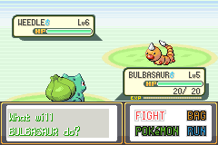
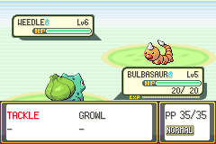

# [FR] Misc Battle engine enhancements
## Credits Compumax, Shiny Miner

Support: https://discord.gg/v8yakmYwFd

 This code enhances the battle engine adding a battle textbox and lighting moves , FIGHT/RUN/POKEMON/BAG options
 Here is the commit I'm referring from : https://github.com/CompuMaxx/TerranovaFR/commit/c19e217d1433d19eb881d4c3b9747ff2e09dd3fd#diff-8285206d44f04f5565566dff2c866e07110570a2a52150600df763d183ccd9fd

How to build:
- Run 'make' command in powershell.
- If you're a newbie and tools like devkiarm,armips, gbagfx, etc not set then follow this guide: https://github.com/Shiny-Miner/GBA-Binary-hacking-assets/wiki/Tutorial-:-Inserting-Shiny-Miner's-some-of-C-injctions